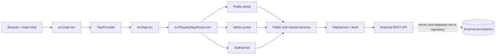

# File Inventory & Mind Map — Canara Bank Employees' Union Welfare Scheme

Legend: [Purpose] then (Ingredients: ...)

Scope: `CANARA_BANK/` only. The application in this directory is a React/TypeScript frontend for the Canara Bank Employees' Union Golden Jubilee Family Welfare Scheme (CBEU GJFWS). Source and configuration were reviewed; generated dependencies and build output are excluded.

## ROOT

- `.gitignore` — Ignore rules. Ingredients: `node_modules`, `dist`, local files, logs, editor files, `.env*`.
- `ARCHITECTURE_OVERVIEW.md` — Existing high-level architecture notes. Ingredients: SPA structure, roles, request flow, external API, deployment, configuration observations.
- `FOLDER_STRUCTURE.md` — Repository tree reference. Ingredients: source, asset, portal, page, service, type, and deployment directories.
- `README.md` — Vite starter documentation. Ingredients: React/Vite setup guidance; it is not a project-specific operations guide.
- `eslint.config.js` — ESLint flat configuration. Ingredients: JavaScript and TypeScript lint rules, React Hooks and refresh plugins, generated/build ignores.
- `index.html` — Vite HTML entry. Ingredients: `#root`, `/src/main.tsx`, viewport metadata, CBEU title, AIBEA logo reference.
- `package.json` — Project manifest. Ingredients: Vite/React/TypeScript, React Router, Bootstrap, table/date/export/chart libraries, JWT helpers, toast/alert libraries; scripts `dev`, `build`, `lint`, `preview`, `start-admin`, `start-public`, `start-staff`, `build-admin`, `build-public`, `build-staff`, `deploy:smarterasp`.
- `package-lock.json` — npm dependency lock. Ingredients: resolved package versions and dependency graph.
- `tsconfig.json` — TypeScript project references. Ingredients: app and node configurations.
- `tsconfig.app.json` — Frontend TypeScript configuration. Ingredients: ES2022/DOM, bundler resolution, React JSX, strict checks, no emit, `src` include.
- `tsconfig.node.json` — TypeScript configuration for Node/Vite-side files. Ingredients: node types and bundler-compatible module settings.
- `vite.config.ts` — Vite setup. Ingredients: React plugin; no separate entry configuration for the three run modes.
- `scripts/deploy-ftp.mjs` — Optional SmarterASP FTPS deployment utility. Ingredients: `basic-ftp`, environment variable names `SMARTERASP_HOST`, `SMARTERASP_USER`, `SMARTERASP_PASSWORD`, `SMARTERASP_REMOTE_DIR`, `DEPLOY_LOCAL_DIR`, `CLEAN_DEPLOY`; uploads the local build directory and optionally clears the remote working directory when `CLEAN_DEPLOY` is `true`.

### `.github/workflows/`

- `.github/workflows/azure-static-web-apps-orange-water-00c2f8200.yml` — Azure Static Web Apps CI/CD. Ingredients: `master` push and pull request triggers, npm build, `dist` output, GitHub OIDC, secret name `AZURE_STATIC_WEB_APPS_API_TOKEN_ORANGE_WATER_00C2F8200`.
- `.github/workflows/smarterasp-deploy.yml` — SmarterASP deployment workflow. Ingredients: push to `Production`, Node 20, `npm ci`, `npm run build`, FTPS deploy of `dist/`; uses secret names `SMARTERASP_USER`, `SMARTERASP_PASSWORD` and variable `SMARTERASP_HOST`.

## FRONTEND

### Application entry and shared routing

- `src/main.tsx` — React bootstrap. Ingredients: `createRoot`, `StrictMode`, global CSS, Bootstrap icons, `YearProvider`, `App`.
- `src/App.tsx` — App shell. Ingredients: `BrowserRouter`, scroll-to-top, Bootstrap CSS, `react-hot-toast` `Toaster`, `AppRoutes`.
- `src/Routes/AppRoutes.tsx` — Route composition. Ingredients: public, admin, and staff route groups; `/unauthorized`; fallback redirect to `/`.
- `src/CONSTANTS/Version.ts` — App version constant. Ingredients: version metadata used by the application.
- `src/index.css` — Global/base styles imported by the entry point. Ingredients: global CSS rules.
- `src/App.css` — Application-level styles. Ingredients: shared app styling.

### Public portal

- `src/PUBLIC-PORTAL/Routes/Route.tsx` — Public route tree under `PublicLayout`. Ingredients: `/`, `/downloads`, `/about-us`, `/managing-committee`, `/rules`, `/claims`, `/contact-us`, `/news`, `/privacy-policy`.
- `src/PUBLIC-PORTAL/Layout/Layout.tsx` — Public portal frame. Ingredients: navbar, outlet/page rendering, footer and shared layout styling.
- `src/PUBLIC-PORTAL/Layout/Navbar.tsx` — Public navigation and login entry. Ingredients: route links, login modal state and public navigation styles.
- `src/PUBLIC-PORTAL/Layout/Footer.tsx` — Public footer. Ingredients: scheme/organization footer content and footer styles.
- `src/PUBLIC-PORTAL/Common/ScrollTop.tsx` — Navigation behavior helper. Ingredients: React Router location observation and scroll reset.
- `src/PUBLIC-PORTAL/Pages/Home.tsx` — Public landing page. Ingredients: hero, featured scheme content, about, news and day quote sections; public content services.
- `src/PUBLIC-PORTAL/Pages/AboutUs.tsx` — About page. Ingredients: scheme background/content and `PublicPage` content configuration.
- `src/PUBLIC-PORTAL/Pages/Claims.tsx` — Public claims statistics and breakdown. Ingredients: death claims, states, designations, years, active public-page copy, settled-claims stats, state/designation tabs, `KiduClaimsTable`.
- `src/PUBLIC-PORTAL/Pages/ContactUs.tsx` — Public contact form. Ingredients: contact message state/validation and `ContactMessage` submission service.
- `src/PUBLIC-PORTAL/Pages/Downloads.tsx` — Public downloads view. Ingredients: public attachment/download listing service and download links.
- `src/PUBLIC-PORTAL/Pages/ManagingCommittee.tsx` — Public committee listing. Ingredients: managing committee service and committee content.
- `src/PUBLIC-PORTAL/Pages/NewPage.tsx` — Public news page. Ingredients: daily news service, news list and page styling.
- `src/PUBLIC-PORTAL/Pages/PrivacyPolicy.tsx` — Privacy information page. Ingredients: static page content and privacy styles.
- `src/PUBLIC-PORTAL/Pages/Rules.tsx` — Scheme rules page. Ingredients: static rule content and rules styles.
- `src/PUBLIC-PORTAL/Pages/Unauthorized.tsx` — Access-denied page. Ingredients: unauthorized message and navigation.
- `src/PUBLIC-PORTAL/Auth/LoginModal.tsx` — Login form/modal. Ingredients: `AuthService.login`, credentials, role-based post-login navigation and feedback.
- `src/PUBLIC-PORTAL/Auth/SignUp.tsx` — Public registration form. Ingredients: registration fields and `AuthService.register`.
- `src/PUBLIC-PORTAL/Auth/ForgotPassword.tsx` — Forgot-password form. Ingredients: email input and `AuthService.forgotPassword`.
- `src/PUBLIC-PORTAL/Auth/ProtectedRoute.tsx` — Client-side route guard. Ingredients: `AuthService.isAuthenticated`, role allow-list (`SystemAdmin`, `Administrator`, `OfficeStaff`, `DEO`), redirect to login-enabled home or role dashboard.
- `src/PUBLIC-PORTAL/Components/Claims/KiduClaimsTable.tsx` — Claims breakdown table. Ingredients: rows with yearly values and totals, used by public claims page.
- `src/PUBLIC-PORTAL/Components/Home/AboutSection.tsx` — Home about panel. Ingredients: about copy/content and component styles.
- `src/PUBLIC-PORTAL/Components/Home/DayQuoteMarquee.tsx` — Day quote display. Ingredients: day quote public service and marquee UI.
- `src/PUBLIC-PORTAL/Components/Home/Featured.tsx` — Featured content panel. Ingredients: scheme highlights and home styles.
- `src/PUBLIC-PORTAL/Components/Home/HeroSection.tsx` — Home hero panel. Ingredients: hero image and public-page content.
- `src/PUBLIC-PORTAL/Components/Home/News.tsx` — Home news preview. Ingredients: public daily news service and news cards.

#### Public portal services, types and styles

- `src/PUBLIC-PORTAL/Services/ClaimSettled.services.ts` — Claims settled statistics client. Ingredients: `CLAIM_SETTLED.GET`, typed stats response.
- `src/PUBLIC-PORTAL/Services/ContactMessage.services.ts` — Contact message client. Ingredients: `CONTACT_MESSAGE.CREATE` and contact message types.
- `src/PUBLIC-PORTAL/Services/DailyNewsPublic.services.ts` — Public news client. Ingredients: `PUBLIC.GET_ALL_DAILYNEWS`.
- `src/PUBLIC-PORTAL/Services/DayQuotePublic.services.ts` — Public quote client. Ingredients: `PUBLIC.GET_ALL_DAYQUOTE`.
- `src/PUBLIC-PORTAL/Services/DownloadsPublic.services.ts` — Public attachment/download client. Ingredients: `PUBLIC.GET_ALL_ATTACHMENTS`, `PUBLIC.GET_ATTACHMENTS_BY_ID`.
- `src/PUBLIC-PORTAL/Services/ManagingCommiteePublic.services.ts` — Public committee client. Ingredients: `PUBLIC.GET_ALL_MANAGINGCOMMITEE`.
- `src/PUBLIC-PORTAL/Services/Publicpage.services.ts` — Public page content client. Ingredients: `PUBLIC.GET_ALL_PUBLICPAGE` and public page types.
- `src/PUBLIC-PORTAL/Types/ClaimSettled.types.ts` — Settled claim response types. Ingredients: aggregate statistics fields.
- `src/PUBLIC-PORTAL/Types/ContactMessage.types.ts` — Contact message payload/response types.
- `src/PUBLIC-PORTAL/Types/PublicPage.types.ts` — Public page content types.
- `src/PUBLIC-PORTAL/Style/` — Public page and layout styles. Ingredients: `AboutUs.css`, `Auth.css`, `Claims.css`, `ContactUs.css`, `DayQuoteMarquee.css`, `Downloads.css`, `Footer.css`, `Home.css`, `ManagingCommittee.css`, `Navbar.css`, `NewsPage.css`, `PrivacyPolicy.css`, `Rules.css`.
- `src/PUBLIC-PORTAL/Style/Home/` — Home-section styles. Ingredients: `AboutSection.css`, `Featured.css`, `Hero.css`, `News.css`.

### Admin portal

- `src/ADMIN-PORTAL/Routes/Route.tsx` — Admin portal route tree. Ingredients: `/dashboard` layout, role guard (`SystemAdmin`, `Administrator`), dashboard, settings masters, users/registrations, contributions, claims/refunds, CMS, reports, support tickets, approvals, administration and notifications routes. The route tree imports feature pages listed below.
- `src/ADMIN-PORTAL/Layout/YearContext.tsx` — Selected-year context. Ingredients: `YearProvider`, `selectedYear`, `setSelectedYear`, `useYear`; initialized from the current year.
- `src/ADMIN-PORTAL/Layout/Sidebar.tsx` — Admin navigation. Ingredients: portal menu links and role-aware navigation.
- `src/ADMIN-PORTAL/Layout/Navbar.tsx` — Admin top bar. Ingredients: profile/settings/notification controls and selected year integration.
- `src/ADMIN-PORTAL/Layout/Profile.tsx` — Admin profile view. Ingredients: current-user information and profile modal integration.
- `src/ADMIN-PORTAL/Layout/ActivityPanel.tsx` — Recent activity panel. Ingredients: dashboard activity presentation.
- `src/ADMIN-PORTAL/Layout/Charts.tsx` — Dashboard charts. Ingredients: Recharts visualizations and dashboard data.
- `src/ADMIN-PORTAL/Layout/ProgressBar.tsx` — Dashboard progress indicators. Ingredients: progress display component.
- `src/ADMIN-PORTAL/Layout/HomePage.tsx` — Admin dashboard shell/home content. Ingredients: dashboard cards, charts, activity and progress components.
- `src/ADMIN-PORTAL/Pages/Dashboard/` — Dashboard components. Ingredients: `DashBoard.tsx` admin layout/router outlet; `DashboardHome.tsx` overview page; `DashBoardCards.tsx` summary cards; `PageNotFound.tsx` admin fallback; `PreLoader.tsx` loading view.
- `src/ADMIN-PORTAL/Pages/Notifications/Notifications.tsx` — Admin notifications page. Ingredients: notification presentation and route integration.
- `src/ADMIN-PORTAL/Components/KiduCreate.tsx` — Reusable create form. Ingredients: field definitions, form state/validation, submit callback and common input controls.
- `src/ADMIN-PORTAL/Components/KiduEdit.tsx` — Reusable edit form. Ingredients: entity data, field definitions, validation and update callback.
- `src/ADMIN-PORTAL/Components/KiduView.tsx` — Reusable record detail view. Ingredients: field display and entity detail layout.
- `src/ADMIN-PORTAL/Components/KiduSubmit.tsx` — Shared submit control. Ingredients: submit button and loading/disabled behavior.
- `src/ADMIN-PORTAL/Components/KiduAccountsettingsModal.tsx` — Account settings dialog. Ingredients: account setting form/modal UI.
- `src/ADMIN-PORTAL/Components/KiduProfileModal.tsx` — Profile dialog. Ingredients: profile view/edit interaction.
- `src/ADMIN-PORTAL/Components/KiduNavbarDropdown.tsx` — Navbar menu dropdown.
- `src/ADMIN-PORTAL/Components/KiduNotificationDropdown.tsx` — Notification menu dropdown.

#### Admin pages by feature

Most admin entity folders use `Create.tsx`, `Edit.tsx`, `List.tsx`, and `View.tsx` for CRUD/detail screens. The pages call feature services under `src/ADMIN-PORTAL/Services/`; their endpoint catalog is in `src/CONSTANTS/API_ENDPOINTS.ts`. Exact page files:

- `src/ADMIN-PORTAL/Pages/Branch/` — `BranchCreateModal.tsx`, `BranchPopup.tsx`, `Circle-StatePopup.tsx`, `Create.tsx`, `Edit.tsx`, `List.tsx`, `View.tsx`; branch/state/circle selection and branch CRUD.
- `src/ADMIN-PORTAL/Pages/Circle/` — `CircleCreateModal.tsx`, `CirclePopup.tsx`, `Create.tsx`, `Edit.tsx`, `List.tsx`, `View.tsx`; circle CRUD and selection.
- `src/ADMIN-PORTAL/Pages/Settings/Category/` — `CategoryCreateModal.tsx`, `CategoryPopup.tsx`, `Create.tsx`, `Edit.tsx`, `List.tsx`, `View.tsx`; category master.
- `src/ADMIN-PORTAL/Pages/Settings/Company/` — `CompanyCreateModal.tsx`, `CompanyPopup.tsx`, `Create.tsx`, `Edit.tsx`, `List.tsx`, `View.tsx`; company master and logo-related form integration.
- `src/ADMIN-PORTAL/Pages/Settings/Designation/` — `Create.tsx`, `DesignationCreateModal.tsx`, `DesignationPopup.tsx`, `Edit.tsx`, `List.tsx`, `View.tsx`; designation master.
- `src/ADMIN-PORTAL/Pages/Settings/Month/` — `Create.tsx`, `Edit.tsx`, `List.tsx`, `MonthCreateModal.tsx`, `MonthPopup.tsx`, `View.tsx`; month master.
- `src/ADMIN-PORTAL/Pages/Settings/ReportEngine/` — `Create.tsx`, `Edit.tsx`, `List.tsx`, `View.tsx`; report engine configuration.
- `src/ADMIN-PORTAL/Pages/Settings/ReportType/` — `Create.tsx`, `Edit.tsx`, `List.tsx`, `ReportTypeCreateModal.tsx`, `ReportTypePopup.tsx`, `View.tsx`; report type master.
- `src/ADMIN-PORTAL/Pages/Settings/State/` — `Create.tsx`, `Edit.tsx`, `List.tsx`, `StateCreateModal.tsx`, `StatePopup.tsx`, `View.tsx`; state master.
- `src/ADMIN-PORTAL/Pages/Settings/Status/` — `Create.tsx`, `Edit.tsx`, `List.tsx`, `StatusCreateModal.tsx`, `StatusPopup.tsx`, `View.tsx`; status master.
- `src/ADMIN-PORTAL/Pages/Settings/UserRoleRight/` — `Create.tsx`, `Edit.tsx`, `List.tsx`, `View.tsx`; role-right configuration.
- `src/ADMIN-PORTAL/Pages/YearMaster/` — `Create.tsx`, `Edit.tsx`, `List.tsx`, `View.tsx`, `YearMasterCreateModal.tsx`, `YearMasterPopup.tsx`; year master management.
- `src/ADMIN-PORTAL/Pages/UserType/` — `Create.tsx`, `Edit.tsx`, `List.tsx`, `View.tsx`; user type management.
- `src/ADMIN-PORTAL/Pages/User/` — `Create.tsx`, `Edit.tsx`, `List.tsx`, `View.tsx`; user management.
- `src/ADMIN-PORTAL/Pages/Contributions/Member/` — `Create.tsx`, `Edit.tsx`, `List.tsx`, `MemberCreateModal.tsx`, `MemberPopup.tsx`, `StatusCard.tsx`, `View.tsx`; membership records and status UI.
- `src/ADMIN-PORTAL/Pages/Contributions/AccountDirectEntry/` — `Create.tsx`, `Edit.tsx`, `List.tsx`, `View.tsx`; direct account contribution entries.
- `src/ADMIN-PORTAL/Pages/Contributions/DirectPay/` — `Create.tsx`, `Edit.tsx`, `List.tsx`, `View.tsx`; direct payment records.
- `src/ADMIN-PORTAL/Pages/Contributions/MonthlyContribution/` — `Create.tsx`, `CreateBranch.tsx`, `CreateCircle.tsx`, `CreateMember.tsx`, `Edit.tsx`, `FileUpload.tsx`, `List.tsx`, `View.tsx`; monthly contribution batches and records, including file upload.
- `src/ADMIN-PORTAL/Pages/Approval/` — `AccountDirectEntryEdit.tsx`, `DeathClaimEdit.tsx`, `DirectPaymentEdit.tsx`, `ExpenseMasterEdit.tsx`, `MonthlyContributionList.tsx`, `MonthlyContributionView.tsx`, `RefundEdit.tsx`, `UserView.tsx`; approval review and state changes for contribution, claims/refunds, expenses and registrations.
- `src/ADMIN-PORTAL/Pages/Claims/DeathClaims/` — `Create.tsx`, `Edit.tsx`, `List.tsx`, `View.tsx`; death claim CRUD/details.
- `src/ADMIN-PORTAL/Pages/Claims/Refund/` — `Create.tsx`, `Edit.tsx`, `List.tsx`, `View.tsx`; refund contribution CRUD/details.
- `src/ADMIN-PORTAL/Pages/Administration/Expense Master/` — `Create.tsx`, `Edit.tsx`, `List.tsx`, `View.tsx`; expense master CRUD.
- `src/ADMIN-PORTAL/Pages/Administration/Expense Type/` — `Create.tsx`, `Edit.tsx`, `ExpenseTypeCreateModal.tsx`, `ExpenseTypePopup.tsx`, `List.tsx`, `View.tsx`; expense type master.
- `src/ADMIN-PORTAL/Pages/Attachment/` — `Create.tsx`, `Edit.tsx`, `List.tsx`, `View.tsx`; attachment management.
- `src/ADMIN-PORTAL/Pages/CMS/ContactMessages/` — `List.tsx`, `View.tsx`; contact submissions review.
- `src/ADMIN-PORTAL/Pages/DailyNews/`, `DayQuote/`, `ManagingCommittee/`, and `PublicPage/` each contain `Create.tsx`, `Edit.tsx`, `List.tsx`, `View.tsx`; corresponding content-management CRUD.
- `src/ADMIN-PORTAL/Pages/Reports/` — `Create.tsx`, `Edit.tsx`, `List.tsx`, `View.tsx`; report configuration and listing.
- `src/ADMIN-PORTAL/Pages/SupportTickets/` — `Create.tsx`, `Edit.tsx`, `List.tsx`, `View.tsx`; support ticket management.

#### Admin services, types, utilities and styling

- `src/ADMIN-PORTAL/Services/Administration/` — `ExpenseMaster.services.ts`, `ExpenseType.services.ts`; expense APIs.
- `src/ADMIN-PORTAL/Services/Claims/` — `DeathClaims.services.ts`, `Refund.services.ts`; claim/refund APIs.
- `src/ADMIN-PORTAL/Services/CMS/` — `ContactMessages.services.ts`, `DailyNews.services.ts`, `DayQuote.services.ts`, `ManagingCommittee.services.ts`, `PublicPage.services.ts`; CMS API wrappers.
- `src/ADMIN-PORTAL/Services/Contributions/` — `AccountDirectEntry.services.ts`, `ContributionDetail.services.ts`, `ContributionMaster.services.ts`, `Directpayment.services.ts`, `Member.services.ts`, `MemberAccountsDetails.services.ts`, `MonthlyContribution.services.ts`, `MonthlyContributionMasters.services.ts`; contribution, member and batch APIs, paging, approval and file upload.
- `src/ADMIN-PORTAL/Services/Dashboard/Dashboard.services.ts` — Dashboard summary, chart and activity endpoints.
- `src/ADMIN-PORTAL/Services/Reports/Reports.services.ts` — Report API wrapper.
- `src/ADMIN-PORTAL/Services/Settings/` — `Branch.services.ts`, `Category.services.ts`, `Circle.services.ts`, `Company.services.ts`, `Designation.services.ts`, `Month.services.ts`, `ReportEngine.services.ts`, `ReportType.services.ts`, `State.services.ts`, `Status.services.ts`, `User.services.ts`, `UserRoleRight.services.ts`, `UserType.services.ts`, `YearMaster.services.ts`; corresponding administration lookup/master APIs.
- `src/ADMIN-PORTAL/Services/SupportTicket/SupportTicket.services.ts` — Support ticket API wrapper.
- `src/ADMIN-PORTAL/Services/UserRegistration/UserRegsitration.servives.ts` — Pending/approved registration operations. The source filename spelling is preserved.
- `src/ADMIN-PORTAL/Types/Administration/` — `ExpenseMaster.types.ts`, `ExpenseType.types.ts`.
- `src/ADMIN-PORTAL/Types/Claims/` — `DeathClaims.type.ts`, `Refund.types.ts`.
- `src/ADMIN-PORTAL/Types/CMS/` — `ContactMessages.types.ts`, `DailyNews.types.ts`, `DayQuote.types.ts`, `ManagingCommittee.types.ts`, `PublicPage.types.ts`.
- `src/ADMIN-PORTAL/Types/Contributions/` — `AccountDirectEntry.types.ts`, `ContributionDetail.types.ts`, `ContributionMaster.types.ts`, `Directpayment.types.ts`, `Member.types.ts`, `MemberAccountsDetails.types.ts`, `MonthlyContribution.types.ts`, `MonthlyContributionMasters.types.ts`.
- `src/ADMIN-PORTAL/Types/Dashboard/` — `Dashboard.types.ts`; `src/ADMIN-PORTAL/Types/Reports/` — `Reports.types.ts`.
- `src/ADMIN-PORTAL/Types/Settings/` — `Branch.types.ts`, `Category.types.ts`, `Circle.types.ts`, `Company.types.ts`, `Designation.types.ts`, `Month.types.ts`, `ReportEngine.types.ts`, `ReportType.types.ts`, `States.types.ts`, `Status.types.ts`, `User.types.ts`, `UserRoleRight.types.ts`, `UserType.types.ts`, `YearMaster.types.ts`.
- `src/ADMIN-PORTAL/Types/SupportTicket/SupportTicket.types.ts` and `src/ADMIN-PORTAL/Types/UserRegistration/UserRegistration.types.ts` — support-ticket and registration contracts.
- `src/ADMIN-PORTAL/Utils/modalZIndex.ts` — Modal stacking helper. Ingredients: shared z-index constants/utility.
- `src/ADMIN-PORTAL/Utils/roleAvatar.ts` — Role/avatar helper. Ingredients: role-to-avatar presentation mapping.
- `src/ADMIN-PORTAL/Style/Sidebar.css` — Admin sidebar styles.

### Staff portal

- `src/STAFF-PORTAL/Routes/Routes.tsx` — Staff route tree under `/staff-portal`. Ingredients: `ProtectedRoute` allow-list `OfficeStaff`, `DEO`; profile, staff edit, contribution list/create/edit/view, settings, contribution history, claims, and refund list/create/edit/view.
- `src/STAFF-PORTAL/Layout/Layout.tsx` — Staff portal frame. Ingredients: sidebar, navbar and nested route outlet.
- `src/STAFF-PORTAL/Layout/Navbar.tsx` — Staff top navigation and account actions.
- `src/STAFF-PORTAL/Layout/Sidebar.tsx` — Staff section links.
- `src/STAFF-PORTAL/Pages/Profile.tsx` — Staff profile. Ingredients: user/member data retrieval and profile rendering.
- `src/STAFF-PORTAL/Pages/StaffEdit.tsx` — Staff/member profile editing. Ingredients: route `memberId`, form state and user/member service calls.
- `src/STAFF-PORTAL/Pages/AccountSetting.tsx` — Staff account settings. Ingredients: password/account update interaction.
- `src/STAFF-PORTAL/Pages/ShowContribution.tsx` — Staff contribution history. Ingredients: contribution record retrieval and history table.
- `src/STAFF-PORTAL/Pages/AccountDirectEntry/` — `Create.tsx`, `Edit.tsx`, `List.tsx`, `View.tsx`; staff direct contribution entry workflow.
- `src/STAFF-PORTAL/Pages/Refund/` — `Create.tsx`, `Edit.tsx`, `List.tsx`, `View.tsx`; staff refund contribution workflow.
- `src/STAFF-PORTAL/Services/AccountDirectEntry.services.ts` — Staff direct entry service. Ingredients: shared `HttpService`, direct-entry endpoints and staff-specific member scoping.
- `src/STAFF-PORTAL/Style/` — Staff styling: `AccountSetting.css`, `DirectContribution.css`, `Layout.css`, `Navbar.css`, `Profile.css`, `ShowContribution.css`, `Sidebar.css`, `Staff.global.css`, `UpdateNominee.css`.

### Shared components, services, and types

- `src/Components/KiduAttachments.tsx` — Attachment list/management UI. Ingredients: attachment service and record context.
- `src/Components/KiduAuditLogs.tsx` — Audit history UI. Ingredients: audit-log service, record/table identifiers.
- `src/Components/KiduButton.tsx` — Shared button primitive.
- `src/Components/KiduCard.tsx` — Shared card/container primitive.
- `src/Components/KiduCreateAttachment.tsx` — Attachment upload/create UI. Ingredients: form data and attachment service.
- `src/Components/KiduCreateModal.tsx` — Reusable create modal wrapper.
- `src/Components/KiduDownload.tsx` — Download interaction. Ingredients: shared file-download service.
- `src/Components/KiduDropdown.tsx` — Reusable dropdown control.
- `src/Components/KiduExcelButton.tsx` — Spreadsheet export control. Ingredients: `xlsx`/export behavior.
- `src/Components/KiduLoader.tsx` — Loading indicator.
- `src/Components/KiduLogoutModal.tsx` — Logout confirmation UI. Ingredients: auth logout action.
- `src/Components/KiduNotes.tsx` — Notes/content display component.
- `src/Components/KiduPopup.tsx` — Popup/modal wrapper.
- `src/Components/KiduPopupButton.tsx` — Popup trigger control.
- `src/Components/KiduPrevious.tsx` — Previous/navigation control.
- `src/Components/KiduReset.tsx` — Form/filter reset control.
- `src/Components/KiduSearchBar.tsx` — Search input component.
- `src/Components/KiduServerTable.tsx`, `KiduServerTableList.tsx`, `KiduServerTableNavbar.tsx` — Reusable server-paginated table, row/list rendering and table controls.
- `src/Components/KiduTableFilter.tsx` — Table filter UI.
- `src/Components/KiduValidation.tsx` — Shared input/form validation helpers and presentation.
- `src/Components/KiduYearSelector.tsx` — Year picker backed by `useYear`.
- `src/Services/Http.services.ts` — Shared fetch client. Ingredients: GET/POST/PUT/DELETE/PATCH, JSON or FormData, Bearer token from `jwt_token`, 401/error handling, authenticated file download.
- `src/Services/Auth.services.ts` — Client authentication/session. Ingredients: login/register/forgot/change password, role validation, `localStorage` session keys, expiry checks, logout, role/dashboard helpers.
- `src/Services/Attachment.services.ts` — Attachment operations. Ingredients: upload, query, edit/delete and download endpoint wrappers.
- `src/Services/AuditLog.services.ts` — Audit-log query wrapper.
- `src/Services/Lookup.services.ts` — Shared lookup/paged lookup service.
- `src/Services/Pagination.services.ts` — Pagination parameter/result helpers.
- `src/Services/PublicService.ts` — Static public content defaults/copy used by public pages.
- `src/Types/ApiTypes.ts` — Shared `CustomResponse<T>` envelope (`statusCode`, `error`, message, success flags, `value`).
- `src/Types/Auth.types.ts` — Login/register/user/forgot-password shapes and `isValidUserRole` for `SystemAdmin`, `Administrator`, `OfficeStaff`, `DEO`.
- `src/Types/Attachment.types.ts` — Shared attachment data contracts.
- `src/Types/AuditLog.types.ts` — Shared audit log/trail contracts.
- `src/Types/Lookup.types.ts` — Shared lookup data contracts.

## BACKEND / API

There is no backend implementation, controller, server route, or API test suite in this repository. The frontend calls a separate REST API. Request fields and server authorization/response behavior cannot be confirmed from this source tree; the client code only establishes the endpoint paths, HTTP method used in each service, and typed response assumptions.

- `src/CONSTANTS/API_ENDPOINTS.ts` — Frontend endpoint catalog. Ingredients: `API_BASE_URL` from `VITE_API_BASE_URL` or a configured default; URL groups for Auth, UserRegistration, AuditLog, Lookup, Dashboard, settings/master data, users, contributions, claims/refunds, attachments, public CMS, reports, support tickets, expenses and role-rights; `getFullImageUrl`, `getBaseWebsiteUrl`.
- `src/Services/Http.services.ts` — HTTP transport layer. Ingredients: `fetch`, bearer header from local storage, JSON/FormData requests, status handling and authenticated downloads. `GET` omits request body.

### Client endpoint groups

Endpoint URL templates are in `API_ENDPOINTS.ts`; entity services select request methods and payloads. Unless a service passes `isPublic=true`, `HttpService` attaches the locally stored bearer token when available.

- Authentication — `POST /Auth/login`, `/Auth/logout`, `/Auth/change-password`, `/Auth/forgot-password`, `/Auth/register` (base prefix `/api`); service payloads include login credentials, `{currentPassword,newPassword}`, forgot-password email, and registration data. Login/register/forgot-password are marked public in the client.
- Registration/audit/lookups — User registration pending/all/by ID and approval URL; audit log by table and record; paged lookup.
- Dashboard — overview, monthly contributions vs claims, claim type distribution, state-wise membership, top-performing states, recent activities, monthly financial comparison and contribution trends.
- Master data — CRUD-style URLs for state, circle, branch, category, company, designation, month, report engine/type, status, user, user type, year master; paged/status/lookup variants.
- Contributions and members — account direct entry, direct payment, member, monthly contribution upload, contribution master and detail operations; includes approve, forward, park/unpark and report/detail routes.
- Claims/refunds — death claim and refund contribution CRUD, approval, member eligibility and next refund number routes.
- CMS/public — attachments upload/query/update/delete/download; contact message submit/list/read/replied; daily news, managing committee, public page and day quote; public news/quote/committee/page/attachment reads and claim-settled aggregate.
- Reporting/administration — reports, support tickets, expense master/type and user-role-right endpoints.

## DATABASE

- Provider/ORM — Not present in this repository. The client uses an external REST API; no database connection string, ORM schema, migration directory, or seed file exists here.
- Data contracts — Types under `src/Types/`, `src/PUBLIC-PORTAL/Types/`, and `src/ADMIN-PORTAL/Types/` describe client-side response/request shapes, not authoritative database models.
- Inferred business entities from endpoint/type names — Members, users, branches, circles, states, monthly/direct contributions, contribution batches/details, death claims, refunds, attachments, audit logs, CMS content, reports, expenses and support tickets. These are API-domain labels only; their server-side schema, relationships, indexes and constraints are not inspectable.

## SHARED LOGIC

- **Startup:** `index.html` loads `src/main.tsx`; React mounts `YearProvider` around `App`.
- **Routing:** `App.tsx` provides `BrowserRouter`; `AppRoutes.tsx` combines portal routes. Admin and staff route subtrees use `ProtectedRoute`; public routes are rendered within `PublicLayout`.
- **Authorization:** Client-side role gating checks local storage through `AuthService`. Admin roles are `SystemAdmin`/`Administrator`; staff roles are `OfficeStaff`/`DEO`. This is frontend navigation protection; backend enforcement is external and not verified here.
- **Session:** `AuthService` stores JWT, user, role, member/staff identifiers and expiry metadata in `localStorage`. `HttpService` sends `Authorization: Bearer ...` for non-public calls when a token exists.
- **State:** Mostly local React state. `YearContext` is the only evident app-wide business context and defaults to the current year.
- **Errors/notifications:** `HttpService` throws on non-2xx responses, with a specific 401 error; pages/services use console logging and toast/alert libraries where implemented.
- **Audit/attachments:** Shared Kidu components call shared services, which call the remote API endpoint catalog.

## ASSETS

- `public/AIBEA_logo.jpg` — Public root logo asset.
- `public/vite.svg`, `src/assets/react.svg` — Vite/React starter assets.
- `public/downloads/Application_for_membership.pdf`, `Authority_letter.pdf`, `Claim_form.pdf`, `Receipt.pdf` — Downloadable public forms/documents.
- `public/web.config` — IIS SPA fallback rewrite to `/` and JSON MIME mapping.
- `src/PUBLIC-PORTAL/Assets/Images/` — `AIBEA_logo.jpg`, `Golden-Jubliee-logo.jpg`, `Hero-image.jpg`, `Logo.jpg`; public branding and hero imagery.
- `src/ADMIN-PORTAL/Assets/Images/` — `admin.png`, `admin.webp`, `aibea.png`, `PF.webp`, `profile.jpg`, `profile.webp`, `sys admin.png`, `sys_Admin.png`, `sys-admin.jpg`; admin/profile/organization visuals.
- `src/ADMIN-PORTAL/Assets/Gif/Loading.webp` — Admin loading animation.
- No font files or dedicated icon asset directory were found. Icons are supplied through installed icon libraries (Bootstrap Icons, Lucide, React Icons).

## TESTS

- No test files, test framework, or test command are present in `CANARA_BANK/`. `package.json` exposes build and lint scripts but no test script.
- `npm run lint` runs ESLint. `npm run build` runs TypeScript checking followed by Vite build; these are validation/build commands, not automated behavioral tests.

## Main Application Architecture



The repository is a frontend-only SPA. React Router selects one of three user experiences: public information pages, role-protected administration screens, and role-protected staff screens. Pages use domain service classes, which form URLs from `API_ENDPOINTS.ts` and call `HttpService`. The server and its persistence layer are outside this repository, so database behavior and API-side authorization are not verified.

## Important Data Flows

### Login and protected navigation

1. Public `LoginModal` submits credentials to `AuthService.login`.
2. `AuthService` sends a public `POST` through `HttpService`; on success it validates the role and writes token/user/role/identifiers/expiry to `localStorage`.
3. `getDashboardRoute()` selects `/dashboard` for administrator roles or `/staff-portal` for staff roles.
4. `ProtectedRoute` checks token presence, expiry and role before rendering protected layouts. Unauthorized users are redirected to home with login state or to their permitted portal.

```mermaid
sequenceDiagram
  participant U as User
  participant L as LoginModal
  participant A as AuthService
  participant H as HttpService
  participant R as ProtectedRoute
  L->>A: login(credentials)
  A->>H: POST /Auth/login (public)
  H-->>A: CustomResponse<LoginResponse>
  A->>A: validate role; persist session in localStorage
  A-->>L: response
  R->>A: isAuthenticated() / getUserRole()
  R-->>U: portal screen or redirect
```

### Admin CRUD and approvals

Admin route pages collect local form/table state, call the matching feature service, and the service calls `HttpService` with the endpoint URL and HTTP method. Approval screens use dedicated approve endpoints where defined. Attachments and audit history use their shared components and endpoint wrappers. Actual server-side validation, transactionality and resulting database changes cannot be inspected.

### Monthly contribution file flow

Monthly contribution pages collect batch metadata and a file. `MonthlyContributionMasterService.uploadAndSave` builds `FormData` with `MonthCode`, `YearOf`, `ContributionFile` and submits it to the upload-and-save endpoint; list/detail/report methods retrieve batches and paginated detail/report data; update sends `FormData` through `PUT`.

### Public content and contact flow

Public pages request published content via public service wrappers (news, day quote, committee, public page, downloads and claim statistics). The contact form calls `ContactMessageService` to submit a public message. Admin CMS pages access matching management services for content editing and message review.

## API Dependency Map

| Frontend consumer | Service/client | Remote API area |
|---|---|---|
| `PUBLIC-PORTAL/Auth/LoginModal.tsx`, `SignUp.tsx`, `ForgotPassword.tsx` | `Services/Auth.services.ts` | `Auth` login/register/forgot-password |
| `PUBLIC-PORTAL/Pages/Claims.tsx` | Claims, settings and public services | `DeathClaim`, `State`, `Designation`, `YearMaster`, `PublicPage`, `ClaimsSettled` |
| Public home/news/committee/download pages | `PUBLIC-PORTAL/Services/*Public.services.ts` and `Publicpage.services.ts` | `Public` read routes |
| `PUBLIC-PORTAL/Pages/ContactUs.tsx` | `ContactMessage.services.ts` | `ContactMessage/submit` |
| Admin dashboard pages/layout | `Dashboard.services.ts` | `Dashboard` aggregates |
| Admin member/contribution pages and approval screens | `ADMIN-PORTAL/Services/Contributions/*` | `Member`, `AccountDirecyEntry`, `DirectPayment`, `MonthlyContribution`, `ContributionMaster`, `ContributionDetail`, `MemberAccountsDetails` |
| Admin claim/refund pages and approval screens | `ADMIN-PORTAL/Services/Claims/*` | `DeathClaim`, `RefundContribution` |
| Admin settings pages | `ADMIN-PORTAL/Services/Settings/*` | State/circle/branch/category/company/designation/month/status/year/user/user type/report and role-right routes |
| Admin CMS pages | `ADMIN-PORTAL/Services/CMS/*`, shared attachment service | `DailyNews`, `DayQuote`, `ManagingComitee`, `PublicPage`, `ContactMessage`, `Attachment` |
| Admin expense, report, support, registration pages | Corresponding `Administration`, `Reports`, `SupportTicket`, `UserRegistration` services | `ExpenseMaster`, `ExpenseType`, `Report`, `SupportTicket`, `UserRegistration` |
| Staff direct entry/refund/profile/history pages | `STAFF-PORTAL/Services/AccountDirectEntry.services.ts` and shared feature services | Direct entry, refund, member/user and contribution routes |

The exact endpoint paths and URL parameters are defined in `src/CONSTANTS/API_ENDPOINTS.ts`; request and response behavior beyond explicitly visible service calls belongs to the external API.

## Database Dependency Map

No server route handlers or database client exist in this repository. The frontend maps features to remote API domain resources as follows:

- Auth and registration — `Auth`, `UserRegistration`, `User`.
- Administration masters — `State`, `Circle`, `Branch`, `Category`, `Company`, `Designation`, `Month`, `Status`, `YearMaster`, `UserType`, `UserRoleRight`.
- Contributions — `Member`, `AccountDirecyEntry`, `DirectPayment`, `MonthlyContribution`, `ContributionMaster`, `ContributionDetail`, `MemberAccountsDetails`.
- Claims and administration — `DeathClaim`, `RefundContribution`, `ExpenseMaster`, `ExpenseType`.
- CMS/support — `Attachment`, `AuditLog`, `ContactMessage`, `DailyNews`, `ManagingComitee`, `PublicPage`, `DayQuote`, `SupportTicket`.
- Dashboard/reports — `Dashboard` aggregates and `Report`, `ReportType`, `ReportEngine` endpoints.

These names are endpoint/resource labels, not confirmed physical database table or ORM model names.

## Shared Component Dependency Map

- `YearProvider` → `App` → admin pages and `KiduYearSelector` consume selected-year state.
- `ProtectedRoute` → admin route tree (`SystemAdmin`, `Administrator`) and staff route tree (`OfficeStaff`, `DEO`).
- `HttpService` → shared `AuthService`, attachment/audit/lookup/pagination services and feature services in admin, public and staff portals.
- `KiduCreate`, `KiduEdit`, `KiduView`, shared Kidu buttons, popup, validation, loader and table components → reusable admin/staff forms and lists.
- `KiduAttachments`, `KiduCreateAttachment`, `KiduDownload` → pages managing or displaying files.
- `KiduAuditLogs` → record detail/edit screens that display audit history.
- Public `Layout`, `Navbar`, `Footer` → all child public routes; home sections are composed by `Home.tsx`.

## Accuracy and inspection notes

- The repository tree contains frontend source, configuration, static assets and deployment workflows. `node_modules/`, `.git/`, and generated/build output were excluded from this inventory.
- No backend source, database schema/migrations/seeds, or tests were found in `CANARA_BANK/`; API and storage details are therefore limited to client-visible contracts and endpoint names.
- `README.md` is still the generic Vite/React starter guide; project-specific architecture notes are in `ARCHITECTURE_OVERVIEW.md`.
- No environment files were read or copied. Environment variable names are documented without values. Deployment credentials remain represented only by workflow secret names.
